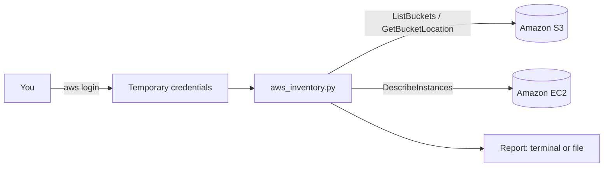

# AWS Audit Tool

A read-only Python command-line tool that reports what is running in an AWS account. It is the first step towards a lightweight **security and cost audit**: finding forgotten resources, risky settings and spend nobody is watching.

On its first run against my own account, it found an S3 bucket in a region I'd forgotten I had used. That is exactly the kind of problem the tool is meant to catch.

**Tech:** Python · boto3 (AWS SDK) · Amazon S3 · Amazon EC2 · AWS IAM · pytest · moto

---

## What it does (v1)

- Lists **every S3 bucket** in the account, with its region and creation date.
- Lists **EC2 instances** in a chosen region, with name, type, state and Availability Zone. It handles paginated API results.
- **Warns about running instances**, because they cost money.
- Prints the report to the terminal and can **save it to a file**.
- Handles missing credentials and permission errors with clear messages instead of a stack trace.

## How it works



## Example output

```
AWS inventory report - 2026-10-24 22:27
EC2 region checked: eu-west-2

S3 buckets (2) - S3 lists all regions at once
  example-old-bucket                       eu-north-1      created 2026-10-16
  example-study-notes                      eu-west-2       created 2026-10-24

EC2 instances in eu-west-2 (0)
  none
```

## Security design

- **Read-only.** The tool only calls `List*`, `Get*` and `Describe*` APIs. It can't create, change or delete anything.
- **No long-term access keys.** Authentication uses `aws login`, which issues short-lived credentials from a console sign-in with MFA. No keys are stored in the project or committed to Git.
- **Least privilege.** It doesn't need admin rights. This IAM policy is enough:

```json
{
  "Version": "2012-10-17",
  "Statement": [
    {
      "Effect": "Allow",
      "Action": [
        "s3:ListAllMyBuckets",
        "s3:GetBucketLocation",
        "ec2:DescribeInstances"
      ],
      "Resource": "*"
    }
  ]
}
```

**Cost:** practically nothing. EC2 `Describe` calls are free, and the few S3 requests per run cost a tiny fraction of a penny.

## Getting started

**Prerequisites:** Python 3.10+, a recent AWS CLI v2 (late 2025 or newer, which includes `aws login`), and an IAM user with console access and MFA.

```bash
git clone https://github.com/cavara/aws-audit-tool.git
cd aws-audit-tool
python -m venv .venv
# Windows: .venv\Scripts\Activate.ps1   macOS/Linux: source .venv/bin/activate
pip install -r requirements.txt

aws login                       # sign in through the browser
python aws_inventory.py         # EC2 region defaults to eu-west-2 (London)
python aws_inventory.py --region eu-north-1 --save report.txt
```

`boto3[crt]` in `requirements.txt` is needed for boto3 to use `aws login` credentials.

## Tests

The tests use **moto** to mock AWS locally, so they need no AWS account and cost nothing:

```bash
python -m pytest -q
```

They cover bucket listing with regions, EC2 instance listing with Name tags, and the running-instance cost warning.

## Project structure

```
aws_inventory.py        # the tool
test_aws_inventory.py   # unit tests (pytest + moto)
requirements.txt
```

## Roadmap

- [x] v1: S3 and EC2 inventory, report to terminal or file, unit tests
- [ ] Flag S3 buckets without **Block Public Access** or **default encryption**
- [ ] Scan **all regions** for EC2 instances
- [ ] Find **unattached EBS volumes** and unused Elastic IPs (wasted spend)
- [ ] Export to **CSV/JSON**
- [ ] **GitHub Actions** workflow to run the tests on every push
- [ ] Run on a schedule with **AWS Lambda + EventBridge**, emailing results through **SNS**

## What I learned

- Setting up an AWS account securely: MFA on the root user, a budget alert, and an IAM user for daily work instead of root.
- Using `aws login` for short-lived credentials instead of access keys, and finding that boto3 needs the `crt` extra to use them.
- AWS API quirks: `GetBucketLocation` returns `None` for us-east-1, and EC2 results come back in pages that need a paginator.
- S3 lists buckets from every region in one call, but EC2 has to be queried region by region. That's how a resource in another region can be forgotten.
- Mocking AWS with moto so tests run quickly, offline, and without touching a real account.

## Author

Jonathan Brome. I'm working towards a cloud engineering role, studying for AWS Solutions Architect Associate (AWS Certified AI Practitioner exam booked for 31 October 2026), CCNA and RHCSA.
